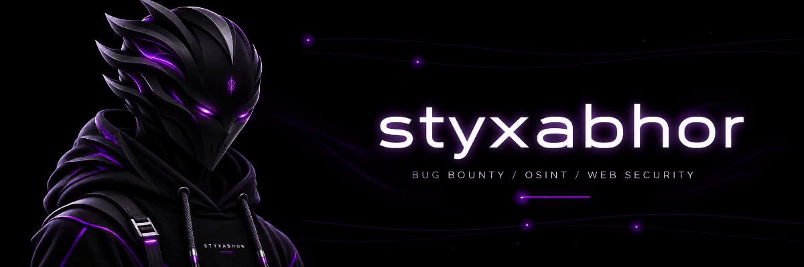
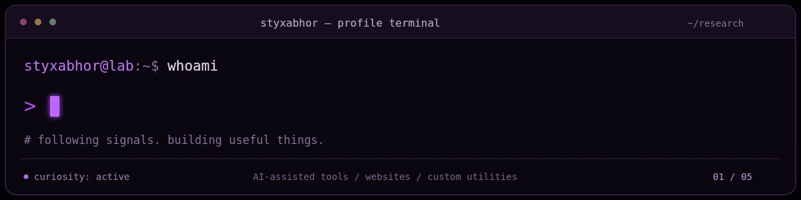

# Hey, I'm Avinash - styxabhor.

  
  
  
  
  

I hunt web vulnerabilities, follow OSINT rabbit holes, and build things that help me investigate and automate. With AI as part of my workflow, I create custom cybersecurity tools, websites, and other practical projects. I also have some experience with Android pentesting and am continuing to learn.

## What keeps me curious

- **Bug bounty & web security:** finding vulnerabilities and understanding how applications behave.
- **OSINT:** following public information and connecting the dots — sometimes just for fun.
- **Android pentesting:** building on the basics through hands-on learning.
- **Building with AI:** turning ideas into security tools, websites, and custom utilities.

## Security toolbox

  
  
  
   
  
  
  
  

## Projects

| Project | What it does |
| --- | --- |
| [Project Lethe](https://github.com/styxabhor/Project-Lethe) | A Python CLI for authorized WAF resilience and canonicalization testing. |
| [StyxAeon](https://github.com/styxabhor/styxaeon) | A geospatial platform for combining and visualizing telemetry. |

I use AI to help turn my ideas into working projects, and refine them as I learn.
